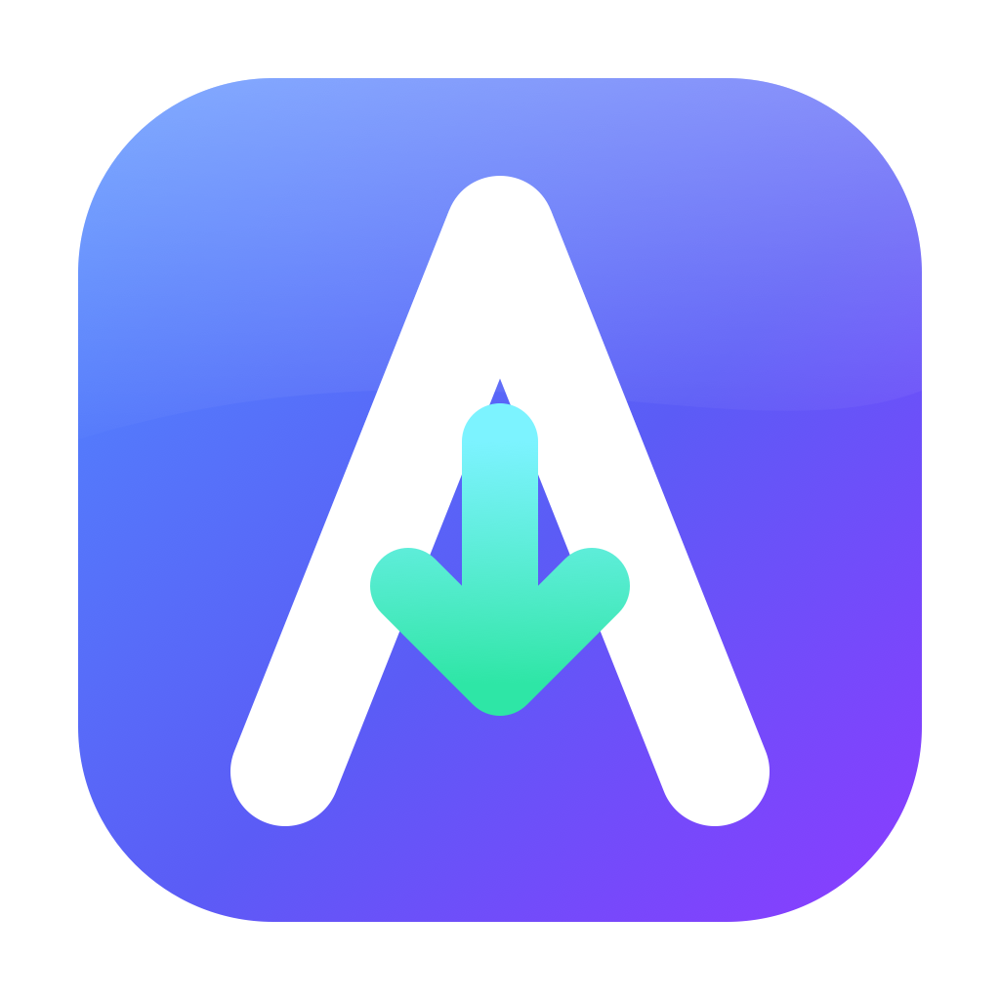

<div align="center">



# ADM - Advanced Download Manager for Windows

**Free, open-source IDM alternative** - fast multi-connection downloader,
YouTube video downloader, HLS / DASH stream saver and torrent client in one app.


[Download](../../releases/latest) · [Features](#features) · [Comparison](#adm-vs-other-download-managers) · [Build from source](#setup-from-source-developers)

</div>

ADM is a lightweight **download manager for Windows** by **Asif Khan**. It
speeds up downloads with parallel segmented connections, takes over your
browser's downloads through a Chrome / Edge / Brave extension, and saves videos
from YouTube, HLS (`.m3u8`) and DASH (`.mpd`) streams as well as torrents and
magnet links. Built with Tauri 2, Rust, React and TypeScript, so it is small,
fast and memory-friendly.

> Looking for a **free Internet Download Manager (IDM) alternative**, a
> **YouTube 4K / MP3 downloader**, or an **m3u8 video downloader**? ADM does
> all of these without ads, trials or a paid licence.

## Features

- **Segmented downloads** - splits a file into parallel connections, with pause / resume.
- **Browser integration** - a Chromium extension (Chrome, Edge, Brave, Vivaldi, Opera) hands downloads to ADM.
- **Video downloads** - YouTube (via bundled `yt-dlp` + `ffmpeg`), HLS (`.m3u8`) and DASH (`.mpd`) streams.
- **Torrents** - magnet links and `.torrent` files.
- **Ad guard** - the extension blocks ~100 ad, tracking and crypto-mining domains.
- **Secure pairing** - the extension must be approved once in ADM before it can send downloads.
- **Silent auto-update** - signed updates install in the background when idle.

## ADM vs other download managers

| Feature | **ADM** | IDM | Free Download Manager | JDownloader | yt-dlp (CLI) |
| --- | :---: | :---: | :---: | :---: | :---: |
| Price | **Free** | Paid (trial) | Free | Free | Free |
| Open source | **Yes** | No | No | Partly | Yes |
| Multi-connection segmented downloads | **Yes** | Yes | Yes | Yes | Limited |
| Browser extension (Chrome / Edge / Brave) | **Yes** | Yes | Yes | Yes | No |
| YouTube video + audio merge (4K, MP3) | **Yes** | Limited | Limited | Yes | Yes |
| HLS `.m3u8` / DASH `.mpd` streams | **Yes** | Partly | Partly | Yes | Yes |
| Torrents & magnet links | **Yes** | No | Yes | No | No |
| Built-in ad / tracker blocker | **Yes** | No | No | No | No |
| Secure extension pairing (token) | **Yes** | - | - | - | - |
| Silent signed auto-update | **Yes** | Prompted | Prompted | Yes | Manual |
| Graphical app, no command line | **Yes** | Yes | Yes | Yes (Java) | No |
| Footprint | **Small (Rust + WebView2)** | Small | Medium | Large (Java) | Tiny |

*Comparison based on the general feature sets of each tool at the time of
writing; check each project for its current features.*

### Why ADM?

- **One app instead of four** - downloader, YouTube saver, stream grabber and torrent client.
- **No ads, no trial, no nag screens.**
- **Privacy first** - the extension never tracks your browsing; only paired extensions can send downloads.
- **Always works with YouTube** - yt-dlp updates itself weekly.

## Install (users)

1. Download `ADM_<version>_x64-setup.exe` from the [Releases](../../releases) page.
2. Run the setup. Everything (app, yt-dlp, ffmpeg, extension) is inside it.
3. Start ADM. Your browser will ask to **enable the extension** on its next
   start, or use **Options -> Browser extension setup...** to load it via
   *Developer mode -> Load unpacked*.

## Setup from source (developers)

### Requirements

| Tool | Version | Link |
| --- | --- | --- |
| Windows | 10 / 11 x64 | |
| Node.js | 20+ | https://nodejs.org |
| Rust | stable (MSVC) | https://rustup.rs |
| Visual Studio Build Tools | "Desktop development with C++" | https://visualstudio.microsoft.com/downloads/ |
| WebView2 | preinstalled on Win 11 | https://developer.microsoft.com/microsoft-edge/webview2/ |

Recommended editor: [VS Code](https://code.visualstudio.com/) +
[Tauri](https://marketplace.visualstudio.com/items?itemName=tauri-apps.tauri-vscode) +
[rust-analyzer](https://marketplace.visualstudio.com/items?itemName=rust-lang.rust-analyzer).

### Steps

```powershell
git clone https://github.com/createwithasif/adm-download-manager.git
cd adm-download-manager

# 1. Fetch yt-dlp.exe and ffmpeg.exe into vendor/ (kept out of git)
powershell -File scripts/fetch-tools.ps1

# 2. Install JS dependencies
npm install

# 3. Run in development mode (hot reload)
npm run tauri dev

# 4. Build the installer (NSIS + MSI)
npm run tauri build
```

The installers land in `src-tauri/target/release/bundle/nsis/` and `.../msi/`.
For signed, auto-updatable releases see [docs/RELEASING.md](docs/RELEASING.md).

### Load the extension while developing

Open `chrome://extensions`, enable **Developer mode**, click **Load unpacked**
and choose the `extension/` folder. Click the extension icon and pair it with
ADM when asked.

## Project structure

```
src/                React + TypeScript UI
  components/       windows and dialogs
  lib/              model, window helpers, updater
src-tauri/          Rust backend (Tauri 2)
  src/engine.rs     segmented download engine
  src/engine/       hls.rs, dash.rs stream downloaders
  src/youtube.rs    yt-dlp / ffmpeg driver
  src/torrent.rs    torrent downloads
  src/bridge.rs     local server the extension talks to (pairing + token)
  src/browser.rs    registers the extension with installed browsers
  src/dns.rs        DNS helpers
  nsis/             installer customisation
extension/          Chromium extension (MV3), ad-guard rules in rules/
scripts/            fetch-tools.ps1, package-extension.ps1
docs/               RELEASING.md, EXTENSION-STORE.md
site/               landing page
```

## YouTube downloads

YouTube serves video and audio as separate, signed streams, so ADM drives
`yt-dlp` for them (`src-tauri/src/youtube.rs`) and lets `ffmpeg` join the two
tracks, the same approach as
[awesome-downloader](https://github.com/Ahmadkhattak1/awesome-downloader).

- Paste a watch, share, Shorts, embed or YouTube Music link into **Add new
  download**, press **Check qualities**, pick one, and start it.
- The browser extension lists the same qualities in its popup on any YouTube page.
- Live streams, and videos that demand sign-in or a bot check, are refused with
  a plain message rather than a stack trace.
- yt-dlp owns its connection, so these downloads can't be paused part way:
  pausing stops it and resuming fetches the same quality from the start.

### The bundled tools

Both tools ship inside the installer, so a user installs ADM and YouTube works:
nothing is downloaded at runtime, and nothing has to be installed by hand.

`scripts/fetch-tools.ps1` puts `yt-dlp.exe` (~22 MB) and `ffmpeg.exe` (~100 MB)
in `vendor/`, which the bundler copies to the app's `tools` folder. They are
kept out of git because of their size. The NSIS installer compresses them with
LZMA, so the setup file stays a fraction of the installed size.

| Installed as | What it is |
| --- | --- |
| `ADM.exe` | the app |
| `tools/yt-dlp.exe` | reads YouTube pages and fetches the streams |
| `tools/ffmpeg.exe` | joins video and audio, makes MP3 |
| `extension/` | the browser extension, ready for "Load unpacked" |

At runtime ADM looks for each tool in the app data `tools` folder, then the
app's own `tools` folder, then `vendor/`, then `PATH`, so a newer yt-dlp can
be dropped into the first one without rebuilding.

ADM checks weekly for a newer yt-dlp and puts it in the app data folder, since
YouTube changes how it serves video every few weeks. Options shows its version
and a "Check now" button.

## The browser extension

The extension ships inside the setup too. On startup ADM registers it with
every Chromium browser it finds under `HKCU`, so the browser shows its own
"Enable extension?" prompt the next time it starts, because no installer may
enable an extension by itself.

That registration needs a published Chrome Web Store listing: package it with
`scripts/package-extension.ps1`, publish it, and put the ID in
`src-tauri/src/browser.rs`. Full steps in
[docs/EXTENSION-STORE.md](docs/EXTENSION-STORE.md).

### Ad guard

A bundled blocklist the browser applies itself through `declarativeNetRequest`.
The extension never watches what you browse, and its popup has an on/off
switch. YouTube's own player requests are left alone.

### Pairing

A local port anyone can reach is a port anyone can use, so ADM does not take a
download from any program that asks. The extension pairs once: it asks, ADM
shows the request with the extension's id, and only after you allow it does ADM
hand over a token that every later request must carry. Options lists what you
have allowed and can forget them all.

## FAQ

**Is ADM a free alternative to IDM?**
Yes. ADM offers multi-connection downloads and browser integration like IDM,
plus YouTube, stream and torrent support, for free.

**Can ADM download YouTube videos in 4K or as MP3?**
Yes. Paste the link, press **Check qualities**, and pick any resolution or MP3.

**How do I download an m3u8 / HLS video?**
Paste the `.m3u8` URL into **Add new download**, or let the extension catch it
while the video plays.

**Does it work with Chrome, Edge, Brave, Opera and Vivaldi?**
Yes, the extension works in every Chromium-based browser.

**Is it safe?**
The code is open source, updates are signed, and the extension needs your
approval before it can send anything to ADM.

## Contributing

Issues and pull requests are welcome. If ADM is useful to you, please **star
the repo** - it helps others find it.

## Licences

See [THIRD-PARTY.md](THIRD-PARTY.md). The bundled FFmpeg is a GPL build.

---

<sub>Keywords: download manager, Windows download manager, IDM alternative,
free internet download manager, download accelerator, YouTube downloader,
YouTube to MP3, 4K video downloader, m3u8 downloader, HLS downloader, DASH
downloader, torrent client, magnet link downloader, Chrome download extension,
Tauri app, Rust download manager, open source.</sub>
